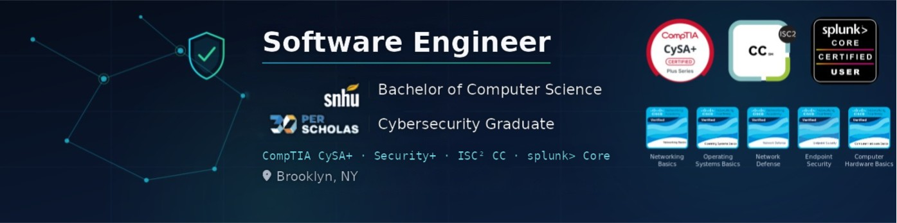

  

# Hi, I'm Amr

CS @ SNHU · Backend & Systems Engineering · C++ · Java · Python  
Brooklyn, NY · [LinkedIn](https://linkedin.com/in/dr3mro) · amr.osman@snhu.edu

---
### Tech Stack

**Languages:**  

**Frameworks & Libraries:**  

---
## What I'm Building

Backend and systems software — REST APIs, desktop applications, OS-level projects.  
Six years of IT and cybersecurity work means authentication, access control, and reliability
are designed in from the start, not bolted on.

| Project | Stack | What it does |
|---|---|---|
| [Valhalla-server](https://github.com/dr3mro/Valhalla-server) | C++20 · Drogon · PostgreSQL · Docker | Multi-tenant healthcare REST backend — 29 endpoints, JWT, bitmask RBAC, CI |
| [SmartClinic](https://github.com/dr3mro/SmartClinic) | C++ · Qt · SQLite | Cross-platform EMR desktop app with multi-specialty record workflows |
| [JSmartClinic](https://github.com/dr3mro/JSmartClinic) | Java · JavaFX | Java reimplementation of SmartClinic |
| [mountain](https://github.com/dr3mro/mountain) | C++ · Qt · SSHFS | macOS menu-bar app for mounting/managing remote SSH storage |
| [JavaSpring](https://github.com/dr3mro/JavaSpringBootApi) | Java · Spring · MySQL | Product-management REST CRUD API with layered architecture |
| [realtime_scheduler](https://github.com/dr3mro/realtime_scheduler) | Python · C | Real-time scheduling algorithms + memory management simulator |

---

## Tech Stack

**Languages:** C++20 · Java · Python · C · SQL · Bash  
**Backend:** Drogon · Spring Boot · PostgreSQL · MySQL · REST API design  
**Desktop:** Qt · JavaFX  
**Tooling:** CMake · Conan · Docker · GitHub Actions CI · Catch2 · clang-tidy  
**Security:** JWT · RBAC · libsodium · input validation · rate limiting  

---

<b>🎓 Certifications & Professional Credentials</b>

 

- **ISC² Certified in Cybersecurity (CC)**
- **CompTIA CySA+** (Cybersecurity Analyst)
- **CompTIA Security+**
- **Splunk > Core Certified Power User**

*B.S. Computer Science @ SNHU (expected Oct 2027) · Seeking software engineering internships.*
